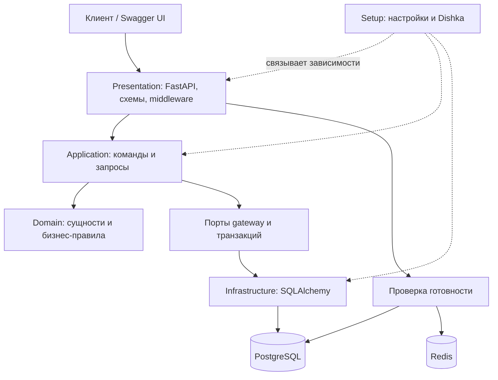

# TrafficMaster

TrafficMaster — веб-бэкенд для изучения правил дорожного движения с интервальным повторением карточек по принципу Anki. Система помогает организовать учебный материал, планировать повторения и отслеживать индивидуальный прогресс.

Целевые пользователи: учащиеся автошкол, кандидаты в водители и водители, повторяющие ПДД. Пользователь создаёт собственные материалы или копирует публичные колоды. Администратор управляет пользователями в пределах своей роли.

В текущую версию входят REST API и Swagger UI. Отдельный frontend, готовая база экзаменационных вопросов, проведение официального экзамена и загрузка изображений не входят в объём версии. Для изображения хранится только необязательная строка `image_path`.

## Пользовательские функции

- Регистрация, вход, выход и управление профилем.
- Создание и редактирование конфигураций обучения и дневных лимитов.
- Создание, редактирование и удаление колод и карточек.
- Публикация колод, просмотр каталога и копирование материалов.
- Работа с вариантами ответов, пояснениями, подсказками и тегами.
- Получение очереди повторений и предварительных интервалов.
- Оценка повторения: AGAIN, HARD, GOOD, EASY.
- Просмотр прогресса, истории и статистики, сброс прогресса.

## Стек технологий

| Назначение | Технологии |
| --- | --- |
| Язык | Python 3.12+ |
| HTTP API и схемы | FastAPI, Uvicorn, Pydantic |
| СУБД и доступ к данным | PostgreSQL 16, SQLAlchemy 2, asyncpg, Alembic |
| Инфраструктура Redis | Redis, redis-py; адаптер хранилища и диагностика доступности |
| Аутентификация | JWT в HttpOnly cookie, серверные сессии PostgreSQL, bcrypt с pepper |
| Внедрение зависимостей | Dishka |
| Инструменты | uv 0.9.26, just, Docker Compose, pytest, Testcontainers, Ruff, mypy, MkDocs |

Redis сейчас не подключён как кэш предметных gateway: бизнес-запросы обращаются к PostgreSQL напрямую. HTTP-заголовки `Cache-Control` управляют клиентским кэшированием отдельно от Redis.

## Архитектура



Зависимости направлены к ядру: domain не зависит от HTTP и СУБД; infrastructure реализует порты application. Подробности: [архитектура](docs/architecture/backend/overview.md).

## Модули и ответственность

| Модуль | Ответственность |
| --- | --- |
| `domain/user`, `application/auth`, команды/запросы user | Пользователи, роли, профиль, вход и отзыв сессий |
| `domain/deck`, команды/запросы deck | Колоды, публичность, копирование и назначение конфигурации |
| Сущность DeckConfig, команды/запросы deck_config | Дневные лимиты, шаги обучения и параметры интервалов |
| `domain/card`, команды/запросы card | Вопросы, варианты ответа, подсказки, теги и путь изображения |
| `domain/card_progress`, команды/запросы card_progress | Индивидуальный прогресс, планировщик, очередь, история и статистика |
| `infrastructure` | ORM, миграции, транзакции, хеширование, JWT, часы, Redis-адаптер |
| `presentation` | HTTP-маршруты, валидация запросов, cookie, ошибки и служебные endpoints |
| `setup` | Конфигурация, сборка приложения и контейнер зависимостей |

## Точки интеграции

- PostgreSQL — источник данных: пользователи, сессии, колоды, конфигурации, карточки, прогресс и история.
- Redis — отдельный сервис с проверкой доступности; отказ Redis отражается как degraded, не блокируя готовность при исправной БД.
- Файловая система — `.env`, миграции и Docker volumes PostgreSQL/Redis. Сервер не загружает и не выдаёт файлы изображений.
- HTTP — клиентский доступ к REST API `/v1`; внешних бизнес-сервисов в текущей версии нет. Keycloak из локального состава удалён; аутентификация собственная.

## Локальная сборка и запуск

Нужны Python 3.12+, **uv 0.9.26**, **just**, Docker Engine и Docker Compose. Проверьте `python3 --version`, `uv --version`, `just --version`, `docker compose version`.

```bash
cp .env.dist .env
uv sync --locked --group dev
```

В `.env` замените `JWT_SECRET` и `PEPPER` своими значениями. При запуске API на хосте оставьте `POSTGRES_HOST=localhost` и `REDIS_HOST=localhost`. Убедитесь, что порты 5432, 6379 и 8080 свободны. Существующий `.env` не перезаписывайте.

```bash
just up
```

Для миграций загрузите `.env` через uv, затем запустите API:

```bash
uv run --env-file .env alembic upgrade head
just uvicorn
```

Рецепт использует `.venv/bin/uvicorn --env-file .env`; активировать окружение не требуется. Если just недоступен, эквивалентные команды:

```bash
docker compose --env-file .env -f docker-compose-local.yaml up -d
.venv/bin/uvicorn trafficmaster.web:create_fastapi_app --factory --env-file .env --host 127.0.0.1 --port 8080
```

- Swagger UI: http://localhost:8080/docs
- `GET /healthcheck/live` — доступность процесса.
- `GET /healthcheck/ready` — готовность БД и состояние Redis.

```bash
curl http://localhost:8080/healthcheck/live
curl http://localhost:8080/healthcheck/ready
```

Остановка инфраструктуры: `just stop`. Сборка образа: `docker build -t trafficmaster .`. Миграции для контейнерного развёртывания выполняются отдельным шагом:

```bash
docker run --rm --env-file /secure/path/trafficmaster.env trafficmaster alembic upgrade head
```

Адрес БД должен быть доступен из контейнера. Настройки и ограничения: [production](docs/production.md).

## Проверки

```bash
.venv/bin/pytest tests/ -q
.venv/bin/pytest tests/unit -q --no-cov
.venv/bin/pytest tests/integration -q --no-cov
.venv/bin/ruff check --no-fix .
.venv/bin/ruff format --check .
.venv/bin/mypy --config-file pyproject.toml
```

Интеграционные тесты создают временные PostgreSQL и Redis через Testcontainers; нужен доступ к Docker daemon. Результаты лабораторной: [верификация](docs/verification.md).

## Лабораторная работа № 1

- [Спецификация требований и use case диаграмма](docs/requirements.md).
- [Матрица и протокол верификации](docs/verification.md).
- [Жизненный цикл прогресса карточки](docs/card-progress-lifecycle.md).
- [Реестр дефектов](ISSUES.md).
- [Первоначальный аудит и выполненные доработки](docs/lab1-audit.md).

## Лабораторная работа № 3

- [План тестирования: объём, стратегия, критерии и формулы метрик](docs/lab3/test-plan.md).
- [Чек-лист всех функциональных требований](docs/lab3/checklist.md).
- [42 тест-кейса с данными, шагами и результатами](docs/lab3/test-cases.md).
- [Протокол выполнения, метрики, трассы и скриншоты](docs/lab3/execution.md).
- [Реестр дефектов с важностью, срочностью и обходами](ISSUES.md).

## Лабораторная работа № 4

- [Объём и воспроизведение](docs/lab4/README.md): API без отдельного frontend, проверки вёрстки неприменимы.
- [Postman: коллекция и покрытие всех операций](docs/lab4/api.md).
- [Базовая безопасность и найденные дефекты](docs/lab4/security.md).
- [Playwright через Swagger UI](docs/lab4/swagger-ui.md).
- [Результаты и доказательства](docs/lab4/results.md).

## Лабораторная работа № 5

- [План нагрузки](docs/lab5/test-plan.md): профиль API, базовый/целевой/стрессовый прогоны и восстановление.
- [Результаты Locust и графики](docs/lab5/results.md).
- [Статическая проверка и исправления](docs/lab5/static-analysis.md).
- [Матрица трассируемости всех требований](docs/lab5/traceability.md).
- [Тесты без точной связи с SRS](docs/lab5/orphan-tests.md).
