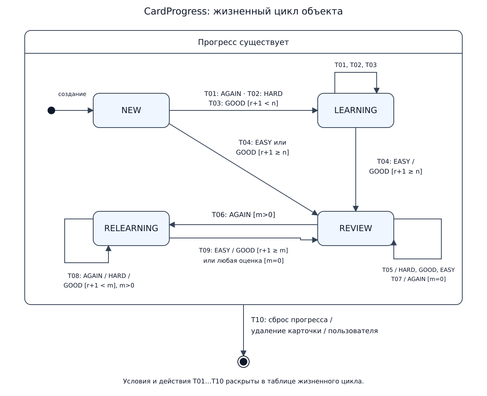

# Жизненный цикл CardProgress

Сущность `CardProgress` представляет прогресс **одного пользователя по одной карточке**. Ключ жизненного цикла — ID прогресса; для пары `(user_id, card_id)` одновременно существует не более одного объекта. Создание, изменение и запись истории выполняются обработчиком повторения в одной транзакции.

Редактируемый источник: [PlantUML](diagrams/card-progress.puml). Для читаемости условия, обозначенные T01…T10, полностью раскрыты в таблице ниже. Все четыре состояния находятся внутри составного состояния «Прогресс существует»; выход из него по удалению применим к любому вложенному состоянию.

## Начальное и конечное состояние

Начальный псевдоузел ведёт в `NEW`: repetitions=0, interval=1, next_review_at=None, ease_factor из конфигурации. В первом HTTP-запросе оценки сразу после создания применяется оценка, поэтому сохранённый объект уже может быть в LEARNING или REVIEW.

`REVIEW` — регулярные повторения, а не конец обучения. Конечный псевдоузел означает **прекращение существования текущего объекта**: сброс прогресса или каскадное удаление карточки/пользователя. Отдельного значения `DELETED` в enum нет. После сброса следующая оценка создаёт другой объект с новым ID. Сброс сохраняет review logs; удаление карточки/пользователя удаляет их каскадно.

## События и условия переходов

`r` — repetitions до оценки; `n` — число learning_steps, `m` — число relearning_steps; now — текущее UTC-время. Оценки: AGAIN=1, HARD=2, GOOD=3, EASY=4. «Назначить шаг k» означает next_review_at=now+steps[k] минут.

| ID | Исходное → новое состояние | Событие / условие | Действие |
| --- | --- | --- | --- |
| T01 | NEW или LEARNING → LEARNING | AGAIN | r=0; назначить шаг 0 обучения. |
| T02 | NEW или LEARNING → LEARNING | HARD | Сохранить r; назначить шаг min(r,n−1). |
| T03 | NEW или LEARNING → LEARNING | GOOD [r+1 < n] | Увеличить r на 1; назначить следующий шаг. |
| T04 | NEW или LEARNING → REVIEW | GOOD [r+1 ≥ n] либо EASY | GOOD: graduating_interval; EASY: easy_interval; r=1, next_review_at=now+interval дней. |
| T05 | REVIEW → REVIEW | HARD, GOOD либо EASY | Пересчитать interval по коэффициентам и просрочке, ограничить max_interval, увеличить r, назначить дату в днях. HARD уменьшает ease, EASY увеличивает ease в пределах 1.3…5.0. |
| T06 | REVIEW → RELEARNING | AGAIN [m > 0] | Снизить ease, пересчитать interval с new_interval и границами, r=0; назначить первый шаг переучивания. |
| T07 | REVIEW → REVIEW | AGAIN [m = 0] | То же снижение ease и interval, r=0, next_review_at в днях; переучивание пропускается. |
| T08 | RELEARNING → RELEARNING | AGAIN, HARD либо GOOD [r+1 < m], при m>0 | AGAIN сбрасывает r; HARD сохраняет; GOOD увеличивает. Назначить соответствующий шаг переучивания. |
| T09 | RELEARNING → REVIEW | EASY либо GOOD [r+1 ≥ m], при m>0; любая оценка при m=0 | interval=max(min_interval, текущий interval), дата в днях. При m>0 r=1, иначе r=0. |
| T10 | Любое существующее состояние → конечный узел | Сброс прогресса; удаление карточки; удаление пользователя | Удалить текущий объект прогресса. |

Во всех переходах по оценке обновляется updated_at и создаётся ReviewLog с **исходным** состоянием. Прямой endpoint оценки не требует, чтобы срок повторения уже наступил; очередь учитывает срок, но не блокирует прямое повторение.

## Связь с реализацией и проверками

- Начало и T01…T09: `src/trafficmaster/domain/card_progress/services/card_progress_service.py`.
- Начало/атомарное сохранение: `application/commands/card_progress/review_card.py`.
- T10 (сброс): `application/commands/card_progress/reset_card_progress.py`.
- T10 (каскад): `infrastructure/persistence/models/card_progress.py`.
- Доменная матрица переходов: `tests/unit/domain/card_progress/services/test_card_progress_service.py`.
- HTTP-последовательность NEW → LEARNING → REVIEW → RELEARNING → REVIEW → завершение → новый объект: `test_learning_lifecycle_and_history` в `tests/integration/http/v1/routes/test_learning.py`.

Связанные требования: FR-15, FR-17, FR-19 и NFR-06. Выбор этой сущности не требует добавлять искусственный статус «выучено навсегда».
