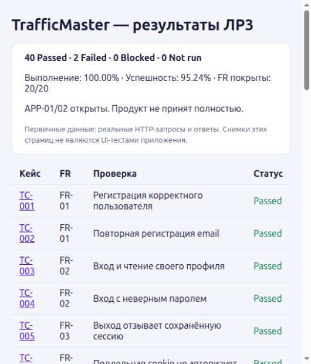

# Протокол выполнения и метрики — ЛР3

Дата: 16.11.2026, Europe/Minsk. Тестируется текущее рабочее дерево, а не только git HEAD. [Окружение и SHA-256 каталога/исполняемых кейсов](evidence/environment.json). Реальные времена начала/окончания каждого кейса находятся в JSON-трассах. Источник плана: [test-plan.md](test-plan.md).

## Запуск

```bash
LAB3_EVIDENCE_DIR=docs/lab3/evidence .venv/bin/pytest tests/integration/lab3 -q --no-cov --tb=short
.venv/bin/python scripts/build_lab3_report.py
```

Первый отладочный прогон содержал две ошибки проверок: ожидание 422 вместо документируемого доменного 400 на нулевой лимит и попытку читать card_state из публичного ответа истории, где поля нет. Проверки исправлены: доменный отказ ожидается как 400; исходные состояния проверяются SELECT в одноразовой БД. Эти ошибки тестового кода не зарегистрированы как дефекты приложения. Итоговая таблица построена по повторному полному прогону текущего каталога. JSON-подготовка данных и SQL-проверки обозначены отдельно от HTTP.

Стандартный вывод итогового прогона 42 кейсов: [pytest.log](evidence/pytest.log). Регрессия ранее существовавшего набора и покрытие: [regression.log](evidence/regression.log). Наборы выполнены отдельными командами: первая попытка общего запуска была прервана средой с кодом 143 без итогового отчёта и не учитывается как успешный прогон. Затем исходный набор повторён с `--ignore=tests/integration/lab3`; каталог ЛР3 полностью выполнен отдельным прогоном выше. Для известных дефектов pytest использует xfail, но здесь их приёмочный статус — Failed. Ошибки инфраструктуры должны отражаться Blocked/Not run, а не успешным результатом; текущие счётчики ниже вычислены по реально записанным кейсам.

Команда регрессии исходного набора:

```bash
.venv/bin/pytest tests/ --ignore=tests/integration/lab3 -q --cov-report=term --cov-report=html --cov-report=xml
```

## Метрики

| Метрика | Расчёт | Значение |
| --- | --- | --- |
| Выполнение | (Passed + Failed) / planned ×100 | (40+2)/42 = 100.00% |
| Успешное прохождение | Passed / executed ×100 | 40/42 = 95.24% |
| Покрытие требований кейсами | FR с кейсами / все FR ×100 | 20/20 = 100.00% |
| FR с полностью успешными кейсами | FR, все кейсы которых Passed / все FR ×100 | 19/20 = 95.00% |
| High-кейсы успешно | Passed High / executed High ×100 | 32/34 = 94.12% |
| Blocked / Not run | Абсолютные значения | 0 / 0 |
| JSON-доказательства | кейсы с трассой / planned | 42/42 |
| Скриншоты | кейсы со снимком / planned | 42/42 |

Исходный регрессионный набор: **483 passed, 2 xfailed**; отдельно каталог ЛР3: **40 passed, 2 xfailed**. Суммарно в двух непересекающихся наборах: 523 passed, 4 xfailed. Два из четырёх xfail — повторные автоматизированные воспроизведения тех же APP-01/02, а не четыре различных дефекта. Покрытие кода по исходному набору — **90,08%** (строки 91,31%, ветви 78,90%); [машиночитаемый расчёт](evidence/coverage-summary.json). Порог 70% выполнен. Дополнительные кейсы ЛР3 не использовались для повышения этого показателя, поскольку приложение для них работает отдельным процессом.

Формулы и соглашения приведены в плане; методичка не предоставлена, точное совпадение с её разделом 6.2 не подтверждается. Покрытие кода — отдельная метрика и не используется вместо покрытия FR. Если успешность считать от всех запланированных, в этом прогоне результат совпадает, поскольку все кейсы выполнены.

### Устранение дефектов по важности

Фиксированный набор — **8 записей ISSUES.md**, включая исторические исправления. Verified fixed: APP-03/04, DOC-03/04; Open: APP-01/02; Resolved awaiting full retest: DOC-01/02. Числитель включает только подтверждённые исправления. Это статус реестра, а не утверждение, что все восемь дефектов вновь обнаружены в этом прогоне.

| Важность | Всего Ds | Подтверждённо устранено Vs | Vs/Ds ×100 |
| --- | --- | --- | --- |
| S1 Blocker | 0 | 0 | N/A |
| S2 Critical: APP-03/04, DOC-01 | 3 | 2 | 66,67% |
| S3 Major: APP-01/02, DOC-02/04 | 4 | 1 | 25,00% |
| S4 Minor: DOC-03 | 1 | 1 | 100,00% |
| Все важности | 8 | 4 | 50,00% |

Отдельно в актуальном API-прогоне воспроизведены два открытых S3 (APP-01/02): устранено 0/2=0%. S2 APP-03/04 не воспроизведены при регрессии TC-025/027/028 и TC-019. Исторические описания и повторные проверки сохранены в ISSUES.md.

## Результаты каждого кейса

| ID | FR | Приоритет | Фактический результат | Статус | Дефект | Доказательства |
| --- | --- | --- | --- | --- | --- | --- |
| TC-001 | FR-01 | High | 4 проверок успешны | Passed | — | [JSON](evidence/TC-001.json), [снимок](evidence/TC-001.jpg), [HTML](evidence/TC-001.html) |
| TC-002 | FR-01 | High | 3 проверок успешны | Passed | — | [JSON](evidence/TC-002.json), [снимок](evidence/TC-002.jpg), [HTML](evidence/TC-002.html) |
| TC-003 | FR-02 | High | 7 проверок успешны | Passed | — | [JSON](evidence/TC-003.json), [снимок](evidence/TC-003.jpg), [HTML](evidence/TC-003.html) |
| TC-004 | FR-02 | High | 4 проверок успешны | Passed | — | [JSON](evidence/TC-004.json), [снимок](evidence/TC-004.jpg), [HTML](evidence/TC-004.html) |
| TC-005 | FR-03 | High | 4 проверок успешны | Passed | — | [JSON](evidence/TC-005.json), [снимок](evidence/TC-005.jpg), [HTML](evidence/TC-005.html) |
| TC-006 | FR-03 | High | 4 проверок успешны | Passed | — | [JSON](evidence/TC-006.json), [снимок](evidence/TC-006.jpg), [HTML](evidence/TC-006.html) |
| TC-007 | FR-04 | High | 6 проверок успешны | Passed | — | [JSON](evidence/TC-007.json), [снимок](evidence/TC-007.jpg), [HTML](evidence/TC-007.html) |
| TC-008 | FR-04 | High | 6 проверок успешны | Passed | — | [JSON](evidence/TC-008.json), [снимок](evidence/TC-008.jpg), [HTML](evidence/TC-008.html) |
| TC-009 | FR-05 | High | 7 проверок успешны | Passed | — | [JSON](evidence/TC-009.json), [снимок](evidence/TC-009.jpg), [HTML](evidence/TC-009.html) |
| TC-010 | FR-05 | High | 6 проверок успешны | Passed | — | [JSON](evidence/TC-010.json), [снимок](evidence/TC-010.jpg), [HTML](evidence/TC-010.html) |
| TC-011 | FR-06 | Medium | 9 проверок успешны | Passed | — | [JSON](evidence/TC-011.json), [снимок](evidence/TC-011.jpg), [HTML](evidence/TC-011.html) |
| TC-012 | FR-06 | Medium | 8 проверок успешны | Passed | — | [JSON](evidence/TC-012.json), [снимок](evidence/TC-012.jpg), [HTML](evidence/TC-012.html) |
| TC-013 | FR-07 | High | 7 проверок успешны | Passed | — | [JSON](evidence/TC-013.json), [снимок](evidence/TC-013.jpg), [HTML](evidence/TC-013.html) |
| TC-014 | FR-07 | High | 8 проверок успешны | Passed | — | [JSON](evidence/TC-014.json), [снимок](evidence/TC-014.jpg), [HTML](evidence/TC-014.html) |
| TC-015 | FR-08 | Medium | 9 проверок успешны | Passed | — | [JSON](evidence/TC-015.json), [снимок](evidence/TC-015.jpg), [HTML](evidence/TC-015.html) |
| TC-016 | FR-08 | Medium | 11 проверок успешны | Passed | — | [JSON](evidence/TC-016.json), [снимок](evidence/TC-016.jpg), [HTML](evidence/TC-016.html) |
| TC-017 | FR-09 | High | 12 проверок успешны | Passed | — | [JSON](evidence/TC-017.json), [снимок](evidence/TC-017.jpg), [HTML](evidence/TC-017.html) |
| TC-018 | FR-09 | High | 7 проверок успешны | Passed | — | [JSON](evidence/TC-018.json), [снимок](evidence/TC-018.jpg), [HTML](evidence/TC-018.html) |
| TC-019 | FR-10 | High | 16 проверок успешны | Passed | — | [JSON](evidence/TC-019.json), [снимок](evidence/TC-019.jpg), [HTML](evidence/TC-019.html) |
| TC-020 | FR-10 | High | 8 проверок успешны | Passed | — | [JSON](evidence/TC-020.json), [снимок](evidence/TC-020.jpg), [HTML](evidence/TC-020.html) |
| TC-021 | FR-11 | High | 8 проверок успешны | Passed | — | [JSON](evidence/TC-021.json), [снимок](evidence/TC-021.jpg), [HTML](evidence/TC-021.html) |
| TC-022 | FR-11 | High | 8 проверок успешны | Passed | — | [JSON](evidence/TC-022.json), [снимок](evidence/TC-022.jpg), [HTML](evidence/TC-022.html) |
| TC-023 | FR-12 | Medium | 13 проверок успешны | Passed | — | [JSON](evidence/TC-023.json), [снимок](evidence/TC-023.jpg), [HTML](evidence/TC-023.html) |
| TC-024 | FR-12 | Medium | 10 проверок успешны | Passed | — | [JSON](evidence/TC-024.json), [снимок](evidence/TC-024.jpg), [HTML](evidence/TC-024.html) |
| TC-025 | FR-13 | High | 17 проверок успешны | Passed | — | [JSON](evidence/TC-025.json), [снимок](evidence/TC-025.jpg), [HTML](evidence/TC-025.html) |
| TC-026 | FR-13 | High | 8 проверок успешны | Passed | — | [JSON](evidence/TC-026.json), [снимок](evidence/TC-026.jpg), [HTML](evidence/TC-026.html) |
| TC-027 | FR-14 | High | 26 проверок успешны | Passed | — | [JSON](evidence/TC-027.json), [снимок](evidence/TC-027.jpg), [HTML](evidence/TC-027.html) |
| TC-028 | FR-14 | High | 11 проверок успешны | Passed | — | [JSON](evidence/TC-028.json), [снимок](evidence/TC-028.jpg), [HTML](evidence/TC-028.html) |
| TC-029 | FR-15 | High | 20 проверок успешны | Passed | — | [JSON](evidence/TC-029.json), [снимок](evidence/TC-029.jpg), [HTML](evidence/TC-029.html) |
| TC-030 | FR-15 | High | 10 проверок успешны | Passed | — | [JSON](evidence/TC-030.json), [снимок](evidence/TC-030.jpg), [HTML](evidence/TC-030.html) |
| TC-031 | FR-16 | High | 10 проверок успешны | Passed | — | [JSON](evidence/TC-031.json), [снимок](evidence/TC-031.jpg), [HTML](evidence/TC-031.html) |
| TC-032 | FR-16 | High | 8 проверок успешны | Passed | — | [JSON](evidence/TC-032.json), [снимок](evidence/TC-032.jpg), [HTML](evidence/TC-032.html) |
| TC-033 | FR-17 | High | 15 проверок успешны | Passed | — | [JSON](evidence/TC-033.json), [снимок](evidence/TC-033.jpg), [HTML](evidence/TC-033.html) |
| TC-034 | FR-17 | High | 11 проверок успешны | Passed | — | [JSON](evidence/TC-034.json), [снимок](evidence/TC-034.jpg), [HTML](evidence/TC-034.html) |
| TC-035 | FR-18 | Medium | 9 проверок успешны | Passed | — | [JSON](evidence/TC-035.json), [снимок](evidence/TC-035.jpg), [HTML](evidence/TC-035.html) |
| TC-036 | FR-18 | Medium | 8 проверок успешны | Passed | — | [JSON](evidence/TC-036.json), [снимок](evidence/TC-036.jpg), [HTML](evidence/TC-036.html) |
| TC-037 | FR-19 | High | 12 проверок успешны | Passed | — | [JSON](evidence/TC-037.json), [снимок](evidence/TC-037.jpg), [HTML](evidence/TC-037.html) |
| TC-038 | FR-19 | High | 11 проверок успешны | Passed | — | [JSON](evidence/TC-038.json), [снимок](evidence/TC-038.jpg), [HTML](evidence/TC-038.html) |
| TC-039 | FR-20 | High | 11 проверок успешны | Passed | — | [JSON](evidence/TC-039.json), [снимок](evidence/TC-039.jpg), [HTML](evidence/TC-039.html) |
| TC-040 | FR-20 | High | 13 проверок успешны | Passed | — | [JSON](evidence/TC-040.json), [снимок](evidence/TC-040.jpg), [HTML](evidence/TC-040.html) |
| TC-041 | FR-01 | High | POST /v1/auth/signup: HTTP 201; actual={'status': 401, 'body': '{"description":"Authentication failed"}'} assert False | Failed | APP-01 | [JSON](evidence/TC-041.json), [снимок](evidence/TC-041.jpg), [HTML](evidence/TC-041.html) |
| TC-042 | FR-01 | High | POST /v1/auth/signup: HTTP 201; actual={'status': 401, 'body': '{"description":"Authentication failed"}'} assert False | Failed | APP-02 | [JSON](evidence/TC-042.json), [снимок](evidence/TC-042.jpg), [HTML](evidence/TC-042.html) |

## Дополнительные проверки комплекта

Ruff: All checks passed; форматирование: 610 files already formatted; mypy: Success, 441 source files. Строгая сборка документации MkDocs прошла. Лог сборки: [mkdocs.log](evidence/mkdocs.log). Синтаксис генератора, наличие всех полей кейсов, пары позитив/негатив для каждого FR и соответствие снимков трассам проверены отдельно.

## Решение по критериям

Все 42 кейса выполнены, каждый Failed связан с дефектом. Условия завершения тестирования оцениваются по счётчикам трасс и снимков выше. **Продукт не принят полностью:** High-кейсы TC-041/042 не прошли, FR-01 не выполнен для допустимых длинных данных. Общий pass rate ≥95% не отменяет провала обязательного требования. Условие отсутствия открытых S1/S2 по полному реестру также не подтверждено закрытием DOC-01: он ожидает полного повторного запуска. Решение о переносе дефектов пользователем не получено.

После исправления необходимо повторить граничные кейсы и полную регрессию; это будущая работа по исправлению продукта, а не недостающая запись результата текущего тестирования. Нагрузочные, полный ручной UI-прогон, production-deploy и реальные отключения зависимостей не выполнены и не выдаются за результаты текущего этапа.

## Скриншоты и первичные данные

Снимки `TC-001.jpg`…`TC-042.jpg` получены в браузере с HTML-страниц **реально выполненного отчёта**. Это скриншоты результатов API-тестов, не изображения ответов Swagger и не синтетические макеты. Каждая HTML-страница содержит критерий, статус, фактические HTTP-коды и последние ответы; полный набор запросов и проверок — в соответствующем JSON. Пароли и токены удалены из трасс. [Обзор результатов](evidence/index.html). [Манифест снимков](evidence/screenshot-manifest.json) содержит время съёмки и SHA-256 снимков и исходных трасс; после нового запуска несовпадающие снимки не засчитываются в метрику доказательств.


