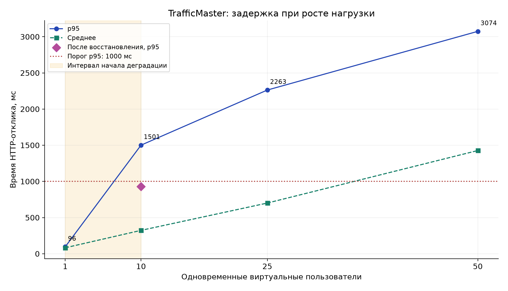
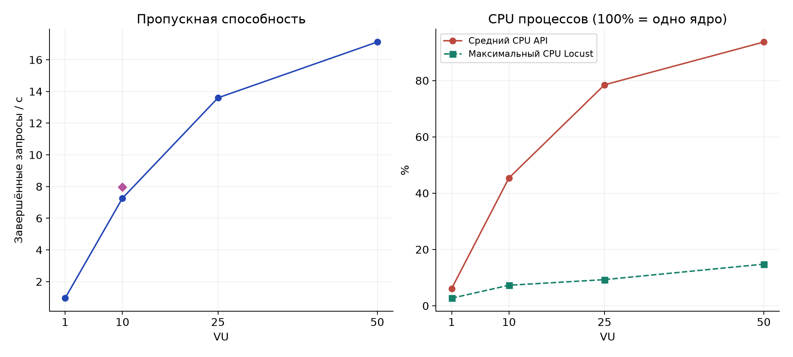

# Результаты нагрузочного тестирования — ЛР5

Фактический прогон: 2026-11-16T19:44:52.144787+03:00 — 2026-11-16T19:51:36.718870+03:00, Europe/Minsk. [План, профиль и критерии](test-plan.md) заданы до измерений. Исходники: loadtests/locustfile.py, loadtests/metrics.py, scripts/run_lab5.py. [Полный runtime JSON](evidence/run.json), [CSV-сводка](evidence/measured-summary.csv), [сырой stdout](evidence/run.log).

## Исправление измерительного стенда

Предварительный отладочный прогон сохранён в evidence/preliminary и исключён из итоговых чисел: CLI --run-time отсчитывался раньше test_start, поэтому в последних строках target/stress-25 число VU успевало снизиться. Остановка перенесена в событие test_start, спустя прогрев, полное окно и 2 неизмеряемые секунды. Профиль, SLO, число VU и длительности измерения не менялись. Итоговый повтор проверен по native CSV User Count: во всех измерительных окнах поддерживается заданное число пользователей. Это исправление инструмента тестирования, не оптимизация продукта.

## Измеренные результаты

Из каждого окна исключены 5 с прогрева и запросы, пересекающие границы измерения. p95 рассчитан nearest-rank по исходным событиям, а не средним из процентов. Все HTTP/семантические ошибки учитывались; ожидаемых 4xx в профиле нет.

| Прогон | VU | Окно, с | Запросы | RPS | Ошибки | Среднее, мс | p50, мс | p95, мс | p99, мс |
| --- | --- | --- | --- | --- | --- | --- | --- | --- | --- |
| baseline | 1 | 45 | 43 | 0.96 | 0 (0.00%) | 82.64 | 53.30 | 96.27 | 1257.30 |
| target | 10 | 30 | 218 | 7.27 | 0 (0.00%) | 323.20 | 61.22 | 1501.15 | 1902.37 |
| stress-25 | 25 | 25 | 340 | 13.60 | 0 (0.00%) | 700.87 | 439.50 | 2262.93 | 2882.82 |
| stress-50 | 50 | 25 | 428 | 17.12 | 0 (0.00%) | 1426.88 | 1321.39 | 3074.29 | 4206.38 |
| recovery | 10 | 30 | 239 | 7.97 | 0 (0.00%) | 231.25 | 42.03 | 928.35 | 1334.68 |

Всего measured-запросов: **1268**, ошибок: **0**. Нулевой error rate не означает отсутствие деградации: задержки нарушают SLO раньше, чем появляются отказы. Native Locust CSV/HTML и полный samples.csv сохранены для каждой ступени.

[Векторный SVG](evidence/latency-vs-users.svg). Линии соединяют измеренные точки для наглядности; дополнительных измерений между ступенями нет. Восстановление при 10 VU показано отдельным ромбом, а не как ещё одна ступень нарастающей нагрузки.

## Начало деградации и восстановление

Первая измеренная деградация — **10 VU**, p95=1501.15 мс. Предыдущая ступень **1 VU** имела p95=96.27 мс. Поэтому граница локализована в интервале **(1; 10] VU** для данного профиля и хоста. Точное значение внутри интервала не измерялось.

На 50 VU стресс остановлен по заранее заданному условию: bounded stop: >5% errors, p95>5s, or two consecutive SLO violations. Ступени выше последней измеренной из верхнего плана **не выполнялись**, поскольку сработало ограничение стресса; 200 — ограничитель, не достигнутая нагрузка. Полный crash не произошёл, что соответствует заданию «до деградации или отказа».

После снятия нагрузки три пары liveness/readiness прошли за **2.11 с**, PID API не менялся. Это время подтверждения трёх здоровых точек, не длительность недоступности: полного отказа не наблюдалось. Затем при 10 VU p95=928.35 мс, error=0.00%, RPS=7.97 — **109.63%** исходного целевого RPS.

- **NFR-07:** Failed на локальном стенде: p95≤1000 мс, ошибки≤1%, RPS≥5, достаточная выборка.
- **NFR-08:** Passed: восстановление≤30 с без перезапуска, стабильные health и последующая нагрузка с RPS≥80% исходного.

Невыполнение целевого NFR-07 в данном итоговом прогоне зарегистрировано как **PERF-01** в ISSUES.md. Это локальное измеренное несоответствие экспериментальному SLO, а не утверждение о производственной аварии.

Recovery и исходный target могут различаться из-за коротких окон, фактического случайного микса и изменившейся БД; более быстрый recovery не означает оптимизацию или гарантированную ёмкость.

Превышение SLO на стрессовых ступенях само по себе не является нарушением обещания NFR-07, которое задано на 10 VU; это измеренный предел данного экземпляра. Подтверждение SLO не отменяет открытые функциональные/безопасностные дефекты ЛР4.

## Показатели по операциям

Глобальный p95 не следует подменять p95 каждой ручки: например, при 10 VU отдельные login/review имеют p95 около/выше 1 с, агрегатный критерий в этом прогоне также нарушен. У baseline 43 запросов и 1 login, поэтому он слабо характеризует хвост распределения аутентификации. Короткие окна не дают доверительных интервалов или гарантии длительной стабильности.

| Прогон | Действие | Число | Фактическая доля | p95, мс |
| --- | --- | --- | --- | --- |
| baseline | GET card | 9 | 20.93% | 36.39 |
| baseline | GET history | 4 | 9.30% | 64.10 |
| baseline | GET queue | 14 | 32.56% | 91.66 |
| baseline | GET stats | 9 | 20.93% | 116.15 |
| baseline | POST login | 1 | 2.33% | 1257.30 |
| baseline | POST review | 6 | 13.95% | 64.44 |
| target | GET card | 36 | 16.51% | 655.06 |
| target | GET history | 24 | 11.01% | 1846.31 |
| target | GET queue | 67 | 30.73% | 1337.19 |
| target | GET stats | 36 | 16.51% | 1744.07 |
| target | POST login | 8 | 3.67% | 1711.03 |
| target | POST review | 47 | 21.56% | 1082.31 |
| stress-25 | GET card | 71 | 20.88% | 2066.56 |
| stress-25 | GET history | 30 | 8.82% | 1286.59 |
| stress-25 | GET queue | 102 | 30.00% | 2148.72 |
| stress-25 | GET stats | 58 | 17.06% | 2178.72 |
| stress-25 | POST login | 14 | 4.12% | 2700.87 |
| stress-25 | POST review | 65 | 19.12% | 2525.40 |
| stress-50 | GET card | 71 | 16.59% | 2435.84 |
| stress-50 | GET history | 38 | 8.88% | 3804.36 |
| stress-50 | GET queue | 129 | 30.14% | 3026.25 |
| stress-50 | GET stats | 72 | 16.82% | 3013.46 |
| stress-50 | POST login | 14 | 3.27% | 3793.27 |
| stress-50 | POST review | 104 | 24.30% | 3496.83 |
| recovery | GET card | 41 | 17.15% | 760.11 |
| recovery | GET history | 19 | 7.95% | 761.68 |
| recovery | GET queue | 71 | 29.71% | 926.97 |
| recovery | GET stats | 45 | 18.83% | 957.71 |
| recovery | POST login | 10 | 4.18% | 1295.33 |
| recovery | POST review | 53 | 22.18% | 932.58 |

## Предположение об узком месте

| Прогон | Средний CPU API | Максимум API | Максимум Locust | Соединения БД, max | Активные SQL, max | Lock wait, max |
| --- | --- | --- | --- | --- | --- | --- |
| baseline | 6.12% | 98.90% | 2.70% | 4 | 1 | 0 |
| target | 45.41% | 100.20% | 7.30% | 10 | 1 | 0 |
| stress-25 | 78.50% | 101.30% | 9.30% | 20 | 11 | 0 |
| stress-50 | 93.69% | 100.80% | 14.80% | 20 | 10 | 0 |
| recovery | 41.42% | 99.40% | 6.50% | 10 | 3 | 0 |

Основная **гипотеза** — насыщение CPU одного Uvicorn worker и блокировка event loop синхронным bcrypt. В `application/auth/log_in.py` async-обработчик непосредственно вызывает синхронный `UserService.verify_password`; адаптер `password_hasher_bcrypt.py` вызывает `bcrypt.checkpw` без передачи работы executor. Во время тяжёлого входа другие async-запросы могут ожидать тот же event loop. Это согласуется с ростом latency всех операций и CPU API около одного ядра, при гораздо меньшем CPU генератора.

При этом пул достигает **20 соединений** (10+10): ограничение пула может дополнительно усиливать очередь. Его нельзя объявить свободным. Снимки показывают существенно меньше активных SQL и нулевые Lock waits, но это **не доказывает**, что БД не влияет: редкий sampling пропускает краткие пики, а завершившийся SQL может удерживать соединение, пока приложение занято CPU. Slow query log, время checkout и CPU-профиль не снимались; отсутствие индекса не установлено и не объявляется причиной.

Для подтверждения нужны отдельные контролируемые опыты: CPU-профиль; ожидание checkout/transaction duration; EXPLAIN ANALYZE главных SQL; A/B вынесение bcrypt из event loop и изменение числа workers. Нельзя ускорять тест снижением bcrypt cost и затем выдавать результат за тот же профиль защиты. Оптимизация кода в этом задании не выполнялась.

## Ограничения интерпретации

Один хост для API, контейнеров и Locust; 1 worker; 20 карточек на аккаунт; 5% входов по весу; короткие окна, одна реализация каждой ступени. Повторения для статистического разброса и длительный soak не проводились. Это выполненная базовая лабораторная проверка, не production capacity planning. CPU считается для процесса (100%=одно логическое ядро), а не как процент всех ядер хоста. Окно CPU привязано к запуску процесса Locust, окно HTTP — к его test_start; возможен небольшой сдвиг старта, поэтому CPU-summary используется как диагностическая оценка, не как точный профиль каждого запроса. Время восстановления из таблицы отсчитывается после завершения процесса Locust; до этого предусмотрен graceful drain запросов до 6 с.

## Исходные файлы

| Прогон | Сырые события | Locust CSV | Native HTML | Ресурсы | Сводка |
| --- | --- | --- | --- | --- | --- |
| baseline | [samples.csv](evidence/baseline/samples.csv) | [stats](evidence/baseline/locust_stats.csv), [history](evidence/baseline/locust_stats_history.csv) | [HTML](evidence/baseline/locust.html) | [JSON](evidence/baseline/resources.json) | [JSON](evidence/baseline/summary.json) |
| target | [samples.csv](evidence/target/samples.csv) | [stats](evidence/target/locust_stats.csv), [history](evidence/target/locust_stats_history.csv) | [HTML](evidence/target/locust.html) | [JSON](evidence/target/resources.json) | [JSON](evidence/target/summary.json) |
| stress-25 | [samples.csv](evidence/stress-25/samples.csv) | [stats](evidence/stress-25/locust_stats.csv), [history](evidence/stress-25/locust_stats_history.csv) | [HTML](evidence/stress-25/locust.html) | [JSON](evidence/stress-25/resources.json) | [JSON](evidence/stress-25/summary.json) |
| stress-50 | [samples.csv](evidence/stress-50/samples.csv) | [stats](evidence/stress-50/locust_stats.csv), [history](evidence/stress-50/locust_stats_history.csv) | [HTML](evidence/stress-50/locust.html) | [JSON](evidence/stress-50/resources.json) | [JSON](evidence/stress-50/summary.json) |
| recovery | [samples.csv](evidence/recovery/samples.csv) | [stats](evidence/recovery/locust_stats.csv), [history](evidence/recovery/locust_stats_history.csv) | [HTML](evidence/recovery/locust.html) | [JSON](evidence/recovery/resources.json) | [JSON](evidence/recovery/summary.json) |
