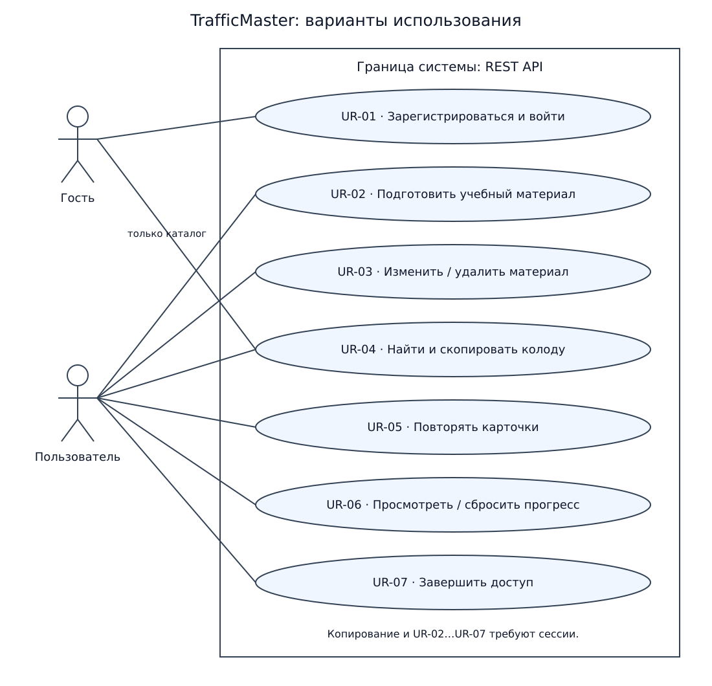

# Спецификация требований TrafficMaster

Версия 1.1, 16.11.2026. Объект: текущий backend TrafficMaster. Приёмочный клиент — HTTP API / Swagger UI. NFR-07/08 добавлены перед нагрузочными прогонами ЛР5; они не приписываются первоначальной версии ЛР1. Проверки исходных требований приведены в [матрице верификации](verification.md), полный актуальный набор — в [трассировке ЛР5](lab5/traceability.md).

## Назначение, проблема и границы

Пользователю трудно систематизировать вопросы ПДД и выбирать, что повторять сегодня. Система хранит материал в колодах, формирует очередь по индивидуальному прогрессу и пересчитывает дату повторения после самооценки ответа. Цель версии — предоставить работающий API для самостоятельного обучения; улучшение результатов реального экзамена этой лабораторной не измеряется.

В объёме: пользователи, собственные и публичные колоды, карточки, конфигурации, очередь, оценки, история, статистика. Вне объёма: отдельный frontend, официальный экзамен, проверка актуальности ПДД, импорт готовых билетов, Keycloak, загрузка/раздача изображений, Redis-кэш предметных запросов. `image_path` — строковое метаданное; существование файла не проверяется.

## Бизнес-требования

| ID | Требование и критерий достижения цели версии |
| --- | --- |
| BR-01 | Обеспечить самостоятельную подготовку: зарегистрированный пользователь создаёт конфигурацию, колоду и карточку, получает её в очереди, оценивает повторение и видит сохранённую историю. |
| BR-02 | Обеспечить персональное планирование: два пользователя одной публичной колоды получают независимые состояния прогресса и историю; оценка одного не меняет прогресс другого. |
| BR-03 | Обеспечить повторное использование материалов: пользователь находит публичную колоду и создаёт собственную приватную копию с отдельными идентификаторами колоды, конфигурации и карточек. |

## Актёры и use case диаграмма

- **Гость** — посетитель без сессии: регистрация, вход, каталог публичных колод.
- **Пользователь** — авторизованный учащийся, владелец материалов и индивидуального прогресса.
- **Администратор** — пользователь с дополнительными правами управления подчинёнными ролями. Администрирование реализовано, но не входит в обязательные семь пользовательских сценариев этой спецификации.

Редактируемый источник: [PlantUML](diagrams/use-cases.puml). Овалы обозначают варианты использования, линии — ассоциации актёров; прямоугольник — границу TrafficMaster. Инфраструктура БД не является пользовательским актёром. Проверка сессии — предусловие UR-02…UR-07, а не отдельная цель пользователя.

## Пользовательские требования и сценарии

| ID | Цель, предусловие и основной сценарий | Результат и альтернативы |
| --- | --- | --- |
| UR-01 | Гость хочет получить доступ: вводит email, имя и пароль, регистрируется и входит. | Создан пользователь, установлена сессия, доступен профиль. Повтор email → 409; неверный пароль → 401. Дефекты длинных значений зарегистрированы в APP-01/02. |
| UR-02 | Пользователь хочет подготовить материал: создаёт конфигурацию, свою колоду и карточку с вопросом, вариантами ответа и подсказкой. | Материал доступен при последующем чтении. Пустой вопрос → 422. |
| UR-03 | Владелец хочет исправить материал: меняет название/публичность колоды, вопрос, тег и строку пути изображения карточки; удаляет ненужные материалы. | Изменения видны при чтении; удалённый объект → 404. Чужому обычному пользователю → 403. |
| UR-04 | Пользователь хочет использовать готовый материал: открывает каталог, выбирает публичную колоду, копирует её. | Получает собственную приватную колоду с копиями конфигурации и карточек. Приватная чужая колода → 403. |
| UR-05 | Пользователь хочет повторять материал: запрашивает очередь доступной колоды, смотрит предварительные интервалы, ставит оценку 1…4. | Сохранены новое состояние, дата следующего повторения и запись истории. Дневные лимиты ограничивают выдачу новых карточек и review, но не запрещают прямой запрос оценки по известному ID. |
| UR-06 | Пользователь хочет оценить прогресс: читает прогресс карточки, историю и статистику колоды, при необходимости сбрасывает прогресс. | Данные относятся к текущему пользователю; сброс удаляет текущий прогресс, сохраняя историю. Отсутствующий прогресс → 404. |
| UR-07 | Пользователь хочет завершить доступ: выходит из системы либо меняет пароль. | При выходе текущая сессия отозвана; после смены пароля прежняя сессия больше не даёт доступ. |

## Функциональные требования

| ID | Приоритет | Обязательное поведение |
| --- | --- | --- |
| FR-01 | High | Регистрация с уникальным корректным email длиной до 254 символов, допустимым именем длиной 5…30 (HTTP-контракт) и паролем длиной 8…255, содержащим буквы и цифры, создаёт пользователя и возвращает 201 с UUID. Повтор email возвращает 409. Дополнительные ограничения имени заданы доменным Username: латиница, цифры, `.`, `_`, `-`, буква/цифра на концах, без последовательных спецсимволов. |
| FR-02 | High | Вход с верными данными возвращает 204, устанавливает cookie `access_token`, а `GET /v1/auth/me` возвращает ID, email и имя текущего пользователя. |
| FR-03 | High | Выход возвращает 204; прежняя сессия после выхода не позволяет получить `/v1/auth/me` (401). |
| FR-04 | High | Смена своего пароля сохраняет новый пароль и отзывает действующие сессии: старый пароль и старая сессия больше не подходят, новый пароль позволяет войти. |
| FR-05 | High | Пользователь создаёт свою конфигурацию обучения; система сохраняет её ID, имя, дневные лимиты, шаги обучения/переучивания и коэффициенты интервалов. |
| FR-06 | Medium | Владелец изменяет имя и дневные лимиты своей конфигурации; последующее чтение возвращает новые значения. |
| FR-07 | High | Пользователь создаёт собственную колоду с существующей конфигурацией; ответ 201 содержит ID, чтение возвращает название и владельца. |
| FR-08 | Medium | Владелец изменяет название и публичность колоды; чтение отражает новые значения. |
| FR-09 | High | Каталог публичных колод содержит публичные колоды; запросы к gateway исключают приватные и применяют limit/offset. |
| FR-10 | High | Копирование доступной колоды создаёт приватную колоду текущего пользователя, отдельную конфигурацию и копии карточек с новыми ID; прогресс исходной колоды не переносится. |
| FR-11 | High | Владелец создаёт карточку с непустым вопросом, вариантами ответа, признаком правильности, пояснениями и подсказкой; последующее чтение возвращает эти данные. |
| FR-12 | Medium | Владелец изменяет вопрос, добавляет тег, задаёт/очищает строку `image_path`; чтение отражает изменения. Загрузка файла не требуется. |
| FR-13 | High | Очередь возвращает карточки доступной колоды для текущего пользователя: сначала наступившие learning/relearning, затем review, затем новые. Число элементов не превышает запрошенный limit. |
| FR-14 | High | Очередь ограничивает новые карточки остатком new_cards_per_day, а review — остатком max_reviews_per_day с учётом истории с начала текущих UTC-суток. Learning/relearning не расходуют эти два лимита выдачи. |
| FR-15 | High | Оценка 1…4 создаёт/обновляет прогресс текущего пользователя, рассчитывает интервал и next_review_at согласно конфигурации и создаёт одну запись истории в общей транзакции. Переходы описаны в [жизненном цикле](card-progress-lifecycle.md). |
| FR-16 | High | Предварительный просмотр возвращает результаты всех четырёх оценок и не сохраняет прогресс или историю. |
| FR-17 | High | Прогресс и история одной карточки изолированы по пользователям; пользователь читает только свой прогресс и свои записи истории. |
| FR-18 | Medium | Статистика доступной колоды возвращает total_cards и количества карточек по состояниям текущего пользователя. |
| FR-19 | High | Сброс прогресса удаляет объект прогресса текущего пользователя, сохраняя историю; чтение прогресса возвращает 404, следующее повторение создаёт новый ID прогресса. |
| FR-20 | High | Владелец удаляет свою карточку, колоду и неиспользуемую конфигурацию; успешный ответ 204, последующее чтение удалённого объекта — 404. |

Приоритеты для ЛР3: **High** — доступ, подготовка материала, каталог и копирование, основное обучение, изоляция, сброс и удаление; **Medium** — изменение настроек/оформления и просмотр статистики. Обязательность FR сохраняется; приоритет задаёт порядок проверок и критерии приёмки.

## Нефункциональные требования

| ID | Обязательное свойство и измеримый критерий |
| --- | --- |
| NFR-01 | Защита пароля: адаптер сохраняет bcrypt-хеш с индивидуальной солью и предварительным HMAC-SHA256 с pepper. Два хеша одного пароля различаются; правильная пара пароль/pepper проходит проверку, неверный пароль или pepper — нет. |
| NFR-02 | Контроль доступа: запрос без сессии к приватным данным возвращает 401; другой обычный пользователь получает 403 при чтении/изменении приватных материалов и при оценке их карточек. Административные исключения определяет AccessService. |
| NFR-03 | Защита сессии: login устанавливает HttpOnly cookie; выход и смена пароля отзывают доступ на сервере, а не только удаляют cookie клиента. |
| NFR-04 | Диагностика отказов: liveness не зависит от БД; readiness возвращает 503 при ошибке БД и 200 с degraded при ошибке только Redis. Проверка каждой зависимости ограничена настраиваемым положительным тайм-аутом (по умолчанию 2 секунды). |
| NFR-05 | Безопасность production-конфигурации: при APP_ENV=production запуск отклоняет debug=true, незащищённую cookie, JWT_SECRET/PEPPER короче 32 символов, wildcard доверенного host и недопустимые CORS origins. |
| NFR-06 | Воспроизводимость схемы и сохранение: на пустой PostgreSQL миграции доходят до head без расхождения с ORM; созданные через HTTP материалы и прогресс читаются в последующих независимых HTTP-запросах из БД. Перезапуск хоста и восстановление из резервной копии не входят в этот критерий. |
| NFR-07 | Экспериментальный SLO ЛР5: на описанном локальном стенде при 10 одновременных пользователях с профилем и паузами из плана p95 HTTP-отклика ≤1000 мс, доля транспортных/HTTP/семантических ошибок ≤1%, пропускная способность ≥5 запросов/с в измеряемом окне после прогрева. Это критерий данного стенда, не производственный SLA. |
| NFR-08 | Восстановление ЛР5: после снятия стрессовой нагрузки без перезапуска API три последовательные пары liveness/readiness дают 200 суммарно за ≤1000 мс каждая в течение 30 с; затем при возврате к 10 пользователям p95 ≤1000 мс, ошибки ≤1%, RPS ≥80% измеренного до стресса целевого RPS. |

## Проверяемость формулировок

Расплывчатые пожелания заменены критериями: «удобно учиться» → BR-01 с завершённым сценарием; «безопасно» → NFR-01…03 и NFR-05; «надёжно» → NFR-04/06; «быстро» не объявлено выполненным без нагрузки и численного SLA. Для каждой строки есть метод и ожидаемый результат в матрице. Отсутствие Redis-кэша и загрузки файлов отражено в границах версии, а не скрыто статусом «реализовано».
